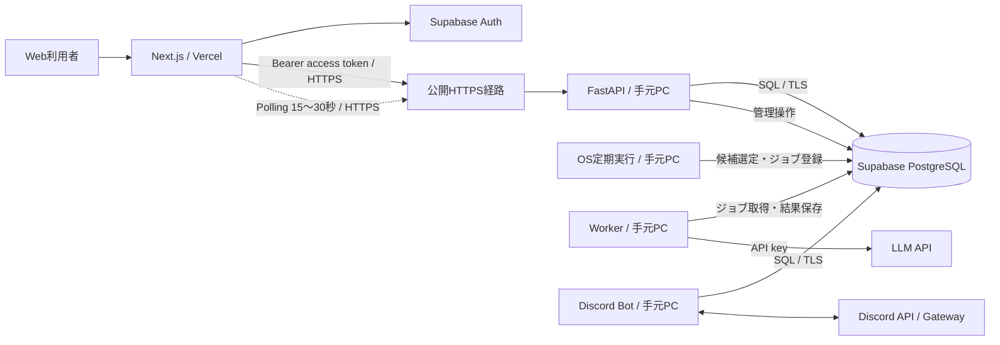

# システム構成

## 通信と整合性

Next.jsは`@supabase/ssr`でCookieセッションを保持する。Server ComponentまたはブラウザのAPIクライアントがSupabase access tokenを`Authorization: Bearer`でFastAPIへ送る。機密データはFastAPI経由に限定し、Supabase publishable keyを持つブラウザから重要テーブルを直接変更させない。認証済み画面のキャッシュを無効にする。APIの所有権判定は [認証](06-authentication-authorization.md)。

API・Worker・Bot・Cronは共通Pythonドメインパッケージと同一DBを使い、HTTPで互いのプロセスを呼ばない。Workerの会話と通知はDBトランザクションで確定し、Discordはoutbox型の通知ジョブを取得する。会話はDBが唯一の正本。Bot停止時も生成は継続し、復帰後に未配信ジョブを拾う。各処理は冪等キーと一意制約で重複を抑止する。詳細は [交流](09-autonomous-interaction.md) と [Discord](11-discord-bot.md)。

MVPはWeb=Vercel Hobby、DB/Auth=Supabase Free、API・Worker・Bot・Scheduler=運営者の手元PCとする（2026-11-14、ADR-015、#75）。API・Worker・Botは同じPC上の独立プロセス、SchedulerはOSからUTCで15分ごとの短命実行とし、共通ドメイン/DBジョブの境界は維持する。プロセス単位で停止/再起動できるが、PC全体・電源・回線は共通の障害点となる。

公開WebのブラウザとVercelのサーバー処理から到達できるHTTPS API URLを用意する。`localhost`は参加者自身/Vercelを指すため使えない。PCのAPIはloopbackで待受け、HTTPSトンネル等の中継を経由する。提供元と固定URLの確保は #34 で検証する。[配置・接続・秘密管理](14-deployment-infrastructure.md)を参照。

PC稼働中は参加者がブラウザを閉じても交流する。停止/スリープ/回線断中はAPI・生成・Discordコマンド/投稿・削除処理が利用できない。Web/DBのクラウド配置だけで24時間利用を保証しない。再開時は現在のスケジュール枠から予約し、停止中の枠をまとめて取り戻す生成を行わない。常時稼働が必要になった場合は、同じ独立プロセスをVPS等へ移す構成を再評価する。

## 障害復旧

Cron多重起動時はDBの一意制約と対象日ロックで同じ予約を作らない。Workerは期限付きleaseを持ち、失効したジョブを再取得する。LLM呼出後のクラッシュでは同一発言IDで保存を試みるが、LLM費用の完全なexactly-onceは保証しないため、再試行回数・予算予約・呼出ログで損失を限定する。Discord投稿直後に応答が失われる境界では二重投稿の可能性が残るため、投稿前に配信IDをDBへ保存し、再起動時はDiscordメッセージIDが不明な配送を自動再送しないで調査キューに回す。

詳細図: [処理シーケンス](diagrams/sequence-diagram.md)。
