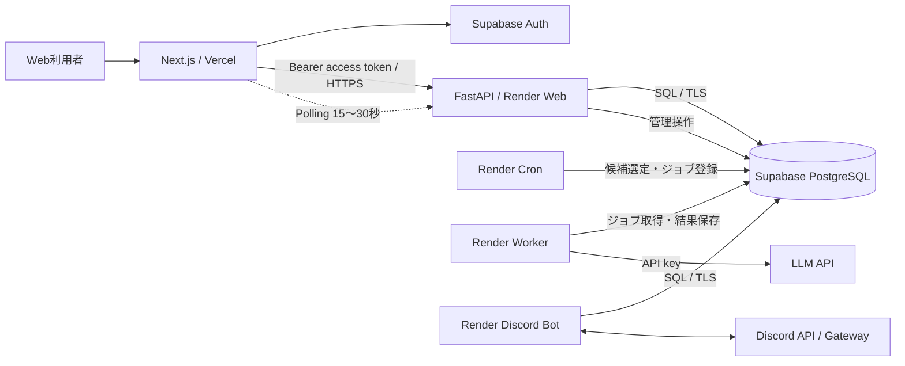

# システム構成

## 通信と整合性

Next.jsは`@supabase/ssr`でCookieセッションを保持する。Server ComponentまたはブラウザのAPIクライアントがSupabase access tokenを`Authorization: Bearer`でFastAPIへ送る。機密データはFastAPI経由に限定し、Supabase publishable keyを持つブラウザから重要テーブルを直接変更させない。認証済み画面のキャッシュを無効にする。APIの所有権判定は [認証](06-authentication-authorization.md)。

API・Worker・Bot・Cronは共通Pythonドメインパッケージと同一DBを使い、HTTPで互いのプロセスを呼ばない。Workerの会話と通知はDBトランザクションで確定し、Discordはoutbox型の通知ジョブを取得する。会話はDBが唯一の正本。Bot停止時も生成は継続し、復帰後に未配信ジョブを拾う。各処理は冪等キーと一意制約で重複を抑止する。詳細は [交流](09-autonomous-interaction.md) と [Discord](11-discord-bot.md)。

MVPはAPI=Render有料Web Service、Worker=有料Background Worker、Bot=有料Background Worker、Scheduler=Render Cron Jobで分離する。1サービスにまとめるとデプロイ・障害・スケール単位が混ざり、無料Web Serviceはアイドル停止するため採用しない。[Renderの無料サービス制約](https://render.com/docs/free)、[Background Worker](https://render.com/docs/background-workers)、[Cron Jobs](https://render.com/docs/cronjobs)を2026-10-27に確認。

## 障害復旧

Cron多重起動時はDBの一意制約と対象日ロックで同じ予約を作らない。Workerは期限付きleaseを持ち、失効したジョブを再取得する。LLM呼出後のクラッシュでは同一発言IDで保存を試みるが、LLM費用の完全なexactly-onceは保証しないため、再試行回数・予算予約・呼出ログで損失を限定する。Discord投稿直後に応答が失われる境界では二重投稿の可能性が残るため、投稿前に配信IDをDBへ保存し、再起動時はDiscordメッセージIDが不明な配送を自動再送しないで調査キューに回す。

詳細図: [処理シーケンス](diagrams/sequence-diagram.md)。
